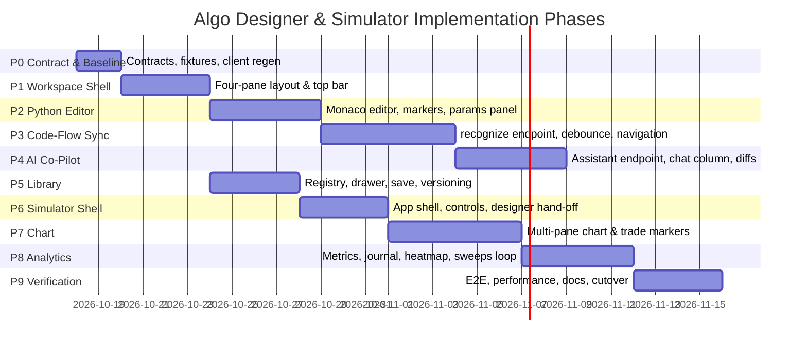

# Honba Algo Designer & Simulator — Phase-Wise Implementation Plan

**Document ID:** HBD-2026-DES-004
**Status:** Approved for Implementation
**Version:** 2.0 (phase-wise plan; supersedes the v1.0 architecture note of the same ID)
**Last updated:** 2026-10-17
**Target Systems:** `honba-frontend`, `honba` (Core Engine + Python control plane), `honba-strategies`, `honba-docs`
**Reference Benchmark:** QuantDinger Platform (`/#/ai-asset-analysis`, `/#/strategy-ide`, `/#/indicator-ide`, `/#/backtest-center`)

**Governing decisions**

| Decision | Scope |
| :--- | :--- |
| [ADR 0029](https://github.com/honba-labs/honba/blob/main/docs/adr/0029-strategy-graph-and-algodesigner.md) | `StrategyGraph` v1, graph↔code round-trip, `verify_graph`/`verify_and_run`, AI assistant hook, ops console, result views (E9-S1..S7) |
| ADR 0017 / 0018 / 0019 | Run lifecycle & `RunId`, risk stage, order-state FSM |
| ADR 0020 / 0021 | Journal schema v1, run event streaming (SSE) |
| ADR 0022 / 0024 | AI strategy verifier, overfitting gates (DSR/PBO/holdout/walk-forward) |
| ADR 0031 / 0032 / 0033 | Signal indicators & chart reasoning, portfolio manager, equity series |

**Companion documents**

- `honba-frontend/docs/AlgoDesigner-PLAN.md` — the canvas-facing plan (Phases 1–8; 1–6 shipped, 7–8 in progress).
- `honba-docs/docs/architecture/event_loop.md` — the deterministic runtime the Simulator drives.
- `honba-docs/docs/backtesting/*` — cost, latency and validation models the Simulator surfaces.

---

## 1. Purpose of This Document

The previous revision of this document (v1.0) described the **target architecture** of two consolidated workspaces — the **Honba Algo Designer** and the **Honba Simulator** — and listed a coarse four-phase roadmap. This revision keeps that architecture as the specification of record and **elaborates it into an executable, phase-wise implementation plan**:

- It records the **baseline** (what already ships in `honba-frontend` and `honba`) so no phase re-plans finished work.
- It corrects one architectural assumption against implementation reality (graph-first, bidirectional sync — see §4.3).
- It decomposes the remaining work into **ten phases (P0–P9)**, each with objectives, work items pinned to real files/endpoints, dependencies, deliverables, acceptance criteria and verification commands.
- It adds a **cross-repo workstream table**, a **risk register** and **quality gates** that a phase must clear before the next begins.

Nothing here is a second source of truth for strategy semantics: the graph document, the generated Python and the Rust `StrategyIr` remain the single contract (ADR 0029 D16).

---

## 2. Executive Summary

Honba is unifying and elevating algorithmic strategy creation, AI co-piloting and institutional simulation by consolidating distinct analytical workflows into two integrated workspaces:

```
+-------------------------------------------------------------------------------+
|                             QuantDinger Workflows                             |
+-------------------------------------------------------------------------------+
|  AI Research              Strategy IDE            Indicator IDE     Backtest  |
|  (/#/ai-asset-analysis)   (/#/strategy-ide)       (/#/indicator-ide)  Center  |
+-------------------------------------------------------------------------------+
                                      |
                     CONSOLIDATION & UNIFICATION
                                      v
+-------------------------------------------------------------------------------+
|                               Honba Ecosystem                                 |
+------------------------------------+------------------------------------------+
|          HONBA ALGO DESIGNER       |             HONBA SIMULATOR              |
|  * Python Code Editor (Monaco)     |  * Event-driven Backtest Engine          |
|  * Interactive Strategy Flow Graph |  * Multi-Pane Interactive Chart Preview  |
|  * AI Strategy Co-Pilot Column     |  * Indicator Visual Sandbox              |
|  * Bidirectional Graph <-> Code    |  * Institutional Performance Analytics   |
|  * Strategy & Indicator Library    |  * Trade Execution Journal & Heatmaps    |
+------------------------------------+------------------------------------------+
```

Two browser entry points, both already registered in `core/apps.ts`:

1. **Honba Algo Designer** (`algodesigner.html` → `src/apps/algodesigner-app.tsx`) — a four-pane workspace: collapsible **Library drawer**, **Python code editor**, **interactive Strategy Flow canvas**, and an **AI Co-Pilot column**, under one contextual top bar (Save, Library, Verify, Simulate →, Export/Theme).
2. **Honba Simulator** (`simulator.html` → `src/apps/simulator-app.tsx`) — a full-lifecycle simulation workbench: universe/benchmark/cost controls, multi-pane price + indicator chart with trade markers, and an institutional analytics bench (equity, drawdown, trade journal, monthly heatmap, trust badges).

**Delivery model.** Ten phases, ~45 ideal engineering days, sequenced P0 → P9 with P5 (Library) parallelisable against P2–P4 and P8 (analytics) reusable across both apps. Each phase ends in a passing, demonstrable slice; there is no "big bang" cutover except deleting the Simulator placeholder in P9.

---

## 3. Product Consolidation: QuantDinger → Honba

Strengths, limitations and Honba's evolution, as established in the v1.0 survey (retained verbatim in intent):

| Dimension | QuantDinger Implementation | Honba Evolution & Target |
| :--- | :--- | :--- |
| **Strategy development** | Standalone Monaco editor in `/#/strategy-ide`; manual tab switching to reach charts/indicators. | **Split-screen dual view**: Python editor and live Strategy Flow always visible together, with the Library one drawer-click away. |
| **Visual flow** | None — strategies exist only as raw Python. | **Derived, bidirectional flow**: the `StrategyGraphShape` renders as typed nodes/edges; code is generated from it and hand-edits are recognised back (ADR 0029 S2/S3). |
| **AI co-pilot** | Right-side prompt composer returning snippets to copy/paste. | **Direct mutation agent**: assistant column with structured graph/code diff cards, one-click **Apply**, full undo via revision snapshots, and ADR 0029 S5 *propose-never-execute* (candidates routed through the verifier before they can run). |
| **Error handling** | Errors surfaced only on "Verify Code" or run. | **Continuous validation**: debounced parse/verify, inline editor markers, and a Flow canvas that never clears on a syntax error — it holds the last valid DAG with a status badge. |
| **Indicator development** | Separate `/#/indicator-ide`; manual conversion to a CTA strategy. | **Unified registry**: indicators and strategies share one catalogue derived from the registered Python indicators; preview in the Simulator or embed in the Designer in one click. |
| **Backtesting** | Results isolated in `/#/backtest-center`. | **Direct "Simulate →" pipeline**: compiled strategy hand-off from Designer to Simulator with the run parameters preserved. |

---

## 4. Baseline Assessment (2026-10-17)

### 4.1 What already ships

**Algo Designer — canvas track (`honba-frontend/docs/AlgoDesigner-PLAN.md`).**

| Phase | Capability | Status |
| :--- | :--- | :--- |
| 1 | Store modernisation: `positions`, selection, `isModified`, revision hashing; freeform canvas (drag/zoom/pan/snap) | Done (`6d1fa5e`) |
| 2 | Categorised node palette (catalogue-introspected); `BaseHonbaNode` + 10 specialised node cards | Done |
| 3 | Port-typed connection validation; `HonbaInsertableEdge` midpoint splicing | Done |
| 4 | Node inspector drawer with dynamic parameter forms; continuous code generation | Done |
| 5 | In-canvas verify/defect locating; run diagnostics; ADR 0029 trust badges; native SVG equity/drawdown; ops console | Done (`4220b86`) |
| 6 | JSON export/replace, SHA-256 version snapshots, unit tests | Done |
| 7 | AI assistant: tri-kind messages (`discussion`/`candidate`/`validation_error`), graph diffs, `applyProposal`, blocked quarantine | In progress (`0b9303c`) — prompt handling is a **local stub** |
| 8 | Sweeps panel: parameter grid, walk-forward config, async job store with `localStorage`, results matrix, "apply optimal" | In progress |

**Backend contracts already exposed** (generated client, `src/core/api/generated/client.ts`):

- `POST /strategies/verify` → `StrategyManifest` in, `StrategyIr` out (`honba-api/src/verify.rs`).
- `POST /backtests`, `GET /backtests/{id}`, `GET /backtests/{id}/journal` → `TradesResponse`.
- `POST /sweeps`, `GET /sweeps/{id}`.
- Profile persistence: `putProfileLayoutsByName`, `putProfileModulesById`.
- Python services: `honba/strategies/graph.py`, `graph_codegen.py`, `graph_recognize.py`, `designer.py` (`verify_graph`, `verify_and_run`, `graph_source_lines`, `diff_graphs`, versions, `trust_badges`), `honba/ai/designer_assistant.py`.

**Frontend building blocks already in `package.json`:** `@xyflow/react@12.12`, `openalgo-charts@2.6.4`, `zustand@5`, `lucide-react`, plus the workbench indicator runtime (`core/indicators`, 502 indicators / 16 categories) and `core/data-layer.ts` + `core/bhavcopy-pool.ts` for bars.

### 4.2 Gap matrix

| Target capability (§5) | Current state | Gap | Phase |
| :--- | :--- | :--- | :--- |
| Four-pane workspace under one top bar | Tab-switched views (`canvas`/`code`/`verify`/…) in `algodesigner-app.tsx` | Layout, resizable splitters, persistent top-bar actions | P1 |
| Rich Python editor with diagnostics | `CodePane` is a plain `<textarea>` | Monaco/CodeMirror, Python language service, marker mapping | P2 |
| Code ↔ Flow continuous sync | Graph → code exists; **no code → graph path in the frontend** | `POST /strategies/recognize` + debounced sync + node-id stabilisation | P3 |
| AI Co-Pilot with real proposals | `proposeAI` keyword stub in `store.ts` | Wire `designer_assistant.py`; code-diff preview; chips | P4 |
| Strategy & Indicator Library | No library UI; `registry.json` unused in app | Registry/`GET /strategies` integration, drawer, save/versioning, fork | P5 |
| Simulator workspace | `simulator-app.tsx` is a 2-line `mountPlaceholder('simulator')` | Entire app: shell, controls, hand-off, run | P6 |
| Multi-pane chart + trade markers | Chart stack exists in Workbench only | Simulator chart wiring, overlay/sub-pane plumbing, journal markers | P7 |
| Analytics bench, journal, heatmap, sweeps hand-off | Native SVG equity/drawdown reusable from P5 canvas work | Metrics ribbon, trade pairing, CSV export, heatmap, sweeps recall | P8 |
| End-to-end verification & cutover | Phase 1–8 unit tests only | Cross-app E2E, performance budgets, docs, placeholder removal | P9 |

### 4.3 Architectural correction: graph-first, not read-only-AST

The v1.0 document described the Flow canvas as a **read-only reflection of Python code** (code → AST → graph). Implementation and ADR 0029 settled the opposite primacy, and this plan adopts it:

- **The `StrategyGraphShape` is authoritative.** The canvas is interactive; `generateCode()` renders it to a deterministic Python module (`graph_codegen`); `source_hash` covers both the module and the `.strategy.json` sidecar.
- **Code is a first-class projection with a return path.** Hand-edits in the editor are recognised back into the graph by `graph_recognize.recognize()` (ADR 0029 S3), which returns `{ graph, spans, code_only }`; non-subset spans are marked `code_only` and are never reconstructed lossily.
- **Therefore the canvas is *bidirectional*, not read-only.** What remains true from v1.0 is the *safety* property: the graph never tears down on invalid input — it holds the last structurally valid DAG and shows "Pending valid syntax…", and node positions are stabilised so layout does not jump.

This correction is the basis of Phase 3 and is called out here so the rest of the document can assume it.

---

## 5. Target Architecture

### 5.1 Invariants

1. **Single source of truth.** Graph (`.strategy.json` / `StrategyGraphShape`) + generated Python + Rust `StrategyIr` share one validation vocabulary; the frontend never executes strategy logic and never computes backtest results locally.
2. **Derived catalogue.** Node types and indicator parameters are introspected from the registered Python indicators (`core/graph/catalogue.ts` mirrors them), never hard-listed.
3. **Typed ports.** Connections are validated by port kind (`series`, `bool`, `size`, `order`); incompatible attempts are rejected with visual feedback.
4. **Safe mutation.** Every graph mutation is snapshot-versioned (SHA-256) and reversible; verify/run operate on the exact graph on screen (`isModified` dirty guard + hash comparison).
5. **Propose-never-execute.** AI candidates and any unverified graph are quarantined from execution until they pass the verifier (ADR 0029 S5).
6. **Reuse, don't re-implement.** Charting uses `openalgo-charts` (already a dependency); analytics equity/underwater stay native SVG (ADR 0029 S7); runs, sweeps, journals and orders go through the existing HTTP client.

### 5.2 Algo Designer workspace

```
+-------------------------------------------------------------------------------------------------------+
|  Top Bar: [Strategy: Momentum_SMA_Cross v1.2] [Save] [Library] [Verify] [Simulate ->] [Export/Theme]   |
+---------------------+-----------------------------+-----------------------------+---------------------+
|   STRATEGY LIBRARY  |      PYTHON CODE EDITOR     |     STRATEGY FLOW CANVAS    |     AI CO-PILOT     |
|   (Collapsible)     |         (Monaco)            |       (@xyflow/react)       |     (Agent Pane)    |
|                     |                             |                             |                     |
| > Built-in CTA      | 1: class SmaCrossover:      |    +-------------------+    | "How can I reduce   |
|   - sma_crossover   | 2:   fast = 10              |    |  Universe: NSE    |    |  max drawdown?"     |
|   - macd_trend      | 3:   slow = 30              |    +---------+---------+    |                     |
| > Mean Reversion    | 4:   def on_bar(self, bar): |              |              | [AI Co-Pilot]       |
| > Custom Saved      | 5:     if cross_above(...): |       +------+------+       | "Add an ATR trailing|
| > Indicators        | 6:       self.buy(qty=100)  |       v             v       |  stop (period=14)." |
|                     | [Ln 5, Col 12] [Clean AST]  |   [Fast SMA]    [Slow SMA]  |                     |
| [New Strategy +]    | [Parameters: fast 10, slow 30] |    +------+------+       | [Diff Preview]      |
|                     |                             |       [Cross Condition]     | + def add_atr_stop()|
|                     |                             |              v              | [Apply to Code]     |
|                     |                             |      [Market Order Buy]     | [Discard]           |
+---------------------+-----------------------------+-----------------------------+---------------------+
```

- **Library drawer (left, collapsible, 280px):** strategies by category (backed by `registry.json` / `GET /strategies`), user-saved strategies, indicator catalogue, "New Strategy".
- **Code editor (centre-left):** Monaco (lazy-loaded), Python highlighting, inline diagnostics mapped from verify issues, parameter declarations.
- **Flow canvas (centre-right):** the existing `canvas.tsx` + `palette.tsx` + `inspector.tsx`; palette may dock inside the drawer in narrow viewports.
- **AI Co-Pilot (right, 380px, collapsible):** conversation, suggestion chips, diff cards, apply/discard.

### 5.3 Bidirectional Code ↔ Flow pipeline

```
[Canvas edit] ---> [Graph mutation in store] --------------------+
                                                                 v
                                                       [generateCode() -> Monaco]
[Editor keystroke]                                                |
        |                                                         |
        v                                                         |
 [Debounce gate: 300ms]                                          |
        |                                                         |
        v                                                         |
 [POST /strategies/recognize]  (graph_recognize.recognize)        |
      /                   \                                       |
 (code_only / spans)   (recognised graph)                        |
      |                     |                                     |
 [Keep last valid graph]  [Diff vs current graph]                 |
 [Inline squiggle]        [Stabilise node positions]              |
 [Badge: "Pending..."]    [Update Flow]  <-----------------------+
                          [Badge: "Graph synced (clean)"]
```

1. **Debounce gate.** Editor keystrokes trigger a 300 ms debounce.
2. **Recognition.** `POST /strategies/recognize` runs `graph_recognize` server-side and returns the recovered graph plus unrecognised line spans (`code_only`).
3. **Graceful error immunity.** On a syntax error or an unrecognised span, Monaco marks the offending line and the canvas retains the last valid DAG with a status badge — it never flickers or clears.
4. **Stabilisation.** Node IDs and existing `positions` are preserved across updates so nodes do not jump (already in `store.ts`).
5. **Editor ↔ canvas navigation.** `graph_source_lines()` maps node IDs to generated-source lines for click-to-focus in both directions.

### 5.4 AI Co-Pilot column

- Persistent right column; message kinds mirror `designer_assistant.py`: `discussion` | `candidate` | `validation_error`.
- Prompt accelerators: *Add ATR trailing stop*, *Add RSI overbought/oversold filter*, *Optimise MA periods for 15m trend*, *Enforce 2% max daily drawdown guard*, *Convert to dual-direction long/short*.
- Conversational context: active graph + generated code + current parameters + last run metrics + instrument metadata.
- Candidates render **interactive diff cards** (graph diff badges already implemented; add unified code diff), with **Apply** (snapshot → `setGraph` → regenerate code → recalc flow) and **Discard**.
- Blocked candidates carry an explicit `BLOCKED` pill and cannot run (ADR 0029 S5).

### 5.5 Strategy & Indicator Library

- **Source:** `honba-strategies/registry.json` (category + indicator-family tags) surfaced by `GET /strategies`, plus user-saved manifests from the profile API and `localStorage`.
- **Saved manifest** (compatible with `honba-strategies`):

```typescript
export interface SavedStrategyManifest {
  id: string;                      // slug, e.g. 'sma_crossover'
  name: string;
  version: string;                 // semver, e.g. '1.2.0'
  category: 'momentum/trend' | 'momentum/breakout' | 'mean_reversion' | 'volatility' | 'options' | 'custom';
  description: string;
  tags: string[];
  author: string;
  updated_at: number;
  python_source: string;
  graph: StrategyGraphShape;
  default_universe: { symbol: string; exchange: string; timeframe: string };
  default_params: Record<string, unknown>;
  backtest_benchmark?: { sharpe_ratio: number; max_drawdown_pct: number; win_rate: number };
}
```

- **Save & revision:** `Ctrl+S`/Save hashes code + graph, persists to `localStorage` and the profile API (`putProfileLayoutsByName` / `putProfileModulesById`), and appends a `DesignerVersion` snapshot.
- **Export / fork:** Python `.py`, JSON manifest, and one-click duplicate.

### 5.6 Simulator workspace

```
+-------------------------------------------------------------------------------------------------------+
|  Top Bar: [Strategy: Momentum_SMA_Cross] [Symbol: NSE:TCS] [Timeframe: 5m] [Period: 6M] [Run Simulation]
+-----------------------------+-------------------------------------------------------------------------+
|     SIMULATION CONTROLS     |                   INTERACTIVE MULTI-PANE CHART                         |
| Symbol: TCS (NSE)           |  Main: candles + Fast/Slow SMA, buy/sell markers                       |
| Benchmark: NIFTY 50         |  Sub-pane 1: RSI 14 (70/30 bands)                                      |
| [1M][3M][6M][1Y][Custom]    |  Sub-pane 2: Volume + VWAP                                             |
| Capital: 100,000 INR        +-------------------------------------------------------------------------+
| Commission / Slippage       |  [Total Return] [CAGR] [Sharpe] [Max DD] [Win Rate] [Profit Factor]   |
| Fill Model: bar_fill        +-------------------------------------------------------------------------+
| [Run Backtest]              |  [Equity / DD] [Trade Journal] [Monthly Returns] [Logs & Events]       |
| [Parameter Sweeps]          |  Equity growth vs benchmark (NIFTY 50)                                  |
+-----------------------------+-------------------------------------------------------------------------+
```

- **Chart engine:** `openalgo-charts` (already used by the Workbench), synchronised panes; **equity/underwater analytics stay native SVG** per ADR 0029 S7.
- **Trade markers:** derived by pairing fills from `GET /backtests/{id}/journal` into round trips; tooltip shows execution price, slippage, size, realised PnL, exit reason.
- **Analytics:** metrics ribbon, equity + underwater, filterable trade journal with CSV export, monthly returns heatmap, and ADR 0029 trust badges (DSR/PBO/holdout/walk-forward) from `ValidationBlock`.

### 5.7 Module layout (current → target)

```
honba-frontend/src/
├── apps/
│   ├── algodesigner-app.tsx                 # shell mount; delegates to workspace/
│   ├── algodesigner/
│   │   ├── workspace-layout.tsx             # NEW  four-pane layout + splitters
│   │   ├── split-pane.tsx                   # NEW  resizable pane primitive
│   │   ├── code-editor-pane.tsx             # NEW  Monaco wrapper (replaces CodePane)
│   │   ├── library-drawer.tsx               # NEW  strategy + indicator browser
│   │   ├── params-panel.tsx                 # NEW  GUI parameter tuner (pythonParams)
│   │   ├── canvas.tsx / palette.tsx / inspector.tsx / nodes/ / edges/   # existing (P1–P4)
│   │   ├── panels.tsx                       # existing verify/run/ops/assistant views
│   │   └── sweeps-panel.tsx                 # existing (P8)
│   ├── simulator-app.tsx                    # REPLACES placeholder
│   └── simulator/
│       ├── components/
│       │   ├── simulation-controls.tsx
│       │   ├── interactive-chart.tsx
│       │   ├── metrics-ribbon.tsx
│       │   ├── equity-curve-card.tsx        # reuses EquityDrawdownChart (SVG)
│       │   ├── trade-journal-table.tsx
│       │   └── monthly-heatmap.tsx
│       └── store/simulator-store.ts
├── core/
│   ├── designer/
│   │   ├── store.ts                         # existing (extend: panes, library, sync)
│   │   ├── assistant-types.ts               # existing
│   │   ├── code-to-graph.ts                 # NEW  debounced recognize() client
│   │   ├── library-store.ts                 # NEW  catalogue + saved manifests
│   │   └── jobs-store.ts / jobs.ts / ops*.ts# existing (P8/P5)
│   └── graph/ (model.ts, codegen.ts, catalogue.ts, validation.ts)   # existing
```

---

## 6. Phase-Wise Implementation Plan

Every phase lists: **Goal**, **Work items** (checkboxed, with file paths and repos), **Dependencies**, **Deliverables**, **Acceptance criteria**, **Verification**.

Repos are abbreviated: **FE** = `honba-frontend`, **HB** = `honba`, **STRAT** = `honba-strategies`, **DOCS** = `honba-docs`.

---

### Phase 0 — Contract, Baseline & Fixture Alignment

**Goal.** Remove unknowns so later phases only write UI. Confirm which backend endpoints exist, add the two missing ones as tracked cross-repo tickets, and freeze regression fixtures.

**Work items**

- [ ] Record the baseline: run `npm run typecheck && npm run test` (FE) and `cargo test` + `pytest` (HB); capture coverage of `core/designer/*` and `core/graph/*`.
- [ ] Freeze fixtures: `defaultGraph()` → `fixtures/graph-sma-cross.json`; a recognised round-trip pair `README-backtest` → graph, for P3 regression.
- [ ] **FE:** regenerate the client (`npm run codegen` → `make -C ../honba schema client`) and diff against `core/types/generated/domain.ts` (known stale: `cancel_requested`, risk/order codes, response `error`).
- [ ] **HB:** confirm the `POST /strategies/recognize` and assistant-invoke contracts (see §8) — endpoints, request/response shapes and error codes.
- [ ] **HB:** confirm the run request surface needed by the Simulator: `BacktestRequest` carries `strategy`, `universe`, `start`, `end`, `bar_spec`, `fill_model`, `initial_capital`, `seed`; `ExecutionConfig` carries `fill_model`, `slippage_multiplier`, `cost_model_version`. Document any missing control (e.g. explicit commission) as a contract gap.
- [ ] **STRAT:** confirm `registry.json` is sufficient to drive the Library (category, tags, description, path) and note any fields the UI needs added.
- [x] **DOCS:** this document is listed in `mkdocs.yml` under Architecture as *Algo Designer & Simulator (plan)*.

**Dependencies.** None.

**Deliverables.** Signed gap matrix (§4.2); regenerated client; two tracked HB endpoint tickets; fixture set.

**Acceptance criteria.** Baseline test commands recorded green; `npm run codegen` diff contains no unexplained drift; endpoint contracts agreed in writing.

**Verification.** `npm run typecheck`, `npm run test`, `cd honba && cargo test`, `pytest`.

---

### Phase 1 — Algo Designer Four-Pane Workspace Shell

**Goal.** Replace the tab-switched app with the persistent four-pane workspace under one contextual top bar, preserving every existing panel as a pane.

**Work items**

- [ ] **FE:** add `apps/algodesigner/split-pane.tsx` — a resizable, keyboard-accessible pane primitive (CSS grid + pointer drag, min/max widths, persisted sizes).
- [ ] **FE:** add `apps/algodesigner/workspace-layout.tsx` — slots for `library | code | canvas | assistant`; collapse/expand for library and assistant; a **focus mode** that expands one pane (the existing tabs become a focus selector, so no capability is lost).
- [ ] **FE:** rewrite `apps/algodesigner-app.tsx` to mount `WorkspaceLayout`; move Verify/Run/Sweeps/Ops/Results panels into a bottom/overlay **drawer** invoked from the top bar.
- [ ] **FE:** extend `core/designer/store.ts`: `layout` slice (`libraryOpen`, `assistantOpen`, pane sizes, `focus`), persisted to `localStorage`.
- [ ] **FE:** re-home `palette.tsx` — dockable to the left rail or embedded in the Library drawer depending on viewport width.
- [ ] **FE:** top bar: `[Strategy name + dirty dot] [Save] [Library] [Verify] [Simulate →] [Export/Theme]`; wire `Ctrl+S`, `Delete`/`Backspace`, `Esc`.
- [ ] **FE:** responsive fallback below 1280 px — canvas + one side pane, others collapsible.

**Dependencies.** P0.

**Deliverables.** `workspace-layout.tsx`, `split-pane.tsx`, reduced `algodesigner-app.tsx`, updated store slice.

**Acceptance criteria.** All eight current tabs are reachable without regression; pane sizes persist across reloads; keyboard shortcuts operate only when focus is not inside the editor; `simulator.html?symbol=…` deep-link entry is unchanged.

**Verification.** `npm run typecheck && npm run test`; manual matrix: every former tab reachable in the new layout; vitest cases for the layout slice (collapse, focus, persistence).

---

### Phase 2 — Python Code Editor (Monaco) & Parameter Panel

**Goal.** Promote the `<textarea>` to a real Python editor with syntax highlighting, inline diagnostics and an introspected parameter panel.

**Decision to record.** Monaco (`@monaco-editor/react`) vs CodeMirror 6. Recommendation: **Monaco**, lazy-loaded via dynamic `import()` and a dedicated Vite chunk (~1 MB gz) because Python diagnostics/autocomplete are first-class; CodeMirror 6 is the fallback if bundle budget becomes binding. Either way the editor is isolated behind `code-editor-pane.tsx`.

**Work items**

- [ ] **FE:** add `apps/algodesigner/code-editor-pane.tsx` — lazy Monaco wrapper; Python language, Honba SDK autocomplete (`self.buy`, `self.sell`, `bar.close`, `bar.volume`, `self.indicators.*`), `editor.defineTheme` against Honba theme tokens.
- [ ] **FE:** map verify issues (`VerifyState.issues[].lineno`) to Monaco markers; clear markers on edit.
- [ ] **FE:** add `apps/algodesigner/params-panel.tsx` — introspects `pythonParams(graph)` (`core/graph/codegen.ts`) into typed controls (number/select/bool) that write back through the existing inspector/params store actions.
- [ ] **FE:** editor header status strip: `[Ln x, Col y] [AST: clean | pending] [hash: abc1234]`.
- [ ] **FE:** ensure undo/redo (`Ctrl+Z`/`Ctrl+Y`) is the editor's own stack and does not fight the store's version snapshots.
- [ ] **FE:** update `algodesigner.html`/`vite.config.*` chunking so Monaco does not inflate the initial Designer bundle.

**Dependencies.** P1.

**Deliverables.** `code-editor-pane.tsx`, `params-panel.tsx`, marker mapping, chunk config.

**Acceptance criteria.** Editing parameters updates generated code and vice-versa; verify issues appear as gutter + squiggle markers on the right lines; initial route load does not include Monaco in the main chunk; `params-panel` round-trips without mutating the graph hash unless a value changed.

**Verification.** `npm run typecheck && npm run test`; a vitest test asserting marker line mapping from a synthetic `VerifyState`; bundle-size check on the Designer entry.

---

### Phase 3 — Bidirectional Code ↔ Flow Synchronisation

**Goal.** Close the loop: hand-edited Python is recognised back into the graph, debounced, error-tolerant, and never loses node positions.

**Work items**

- [ ] **HB:** add REST `POST /strategies/recognize` wrapping `graph_recognize.recognize()`; response `{ graph | null, spans: [{start_line, end_line, reason}], code_only: boolean }`; 422 with `reason=code_only` is **not** an error — it is a normal result.
- [ ] **HB:** expose `graph_source_lines()` for node↔line mapping in the same response (or a sibling endpoint) so both navigation directions use one call.
- [ ] **FE:** add `core/designer/code-to-graph.ts` — 300 ms debounced call, `AbortController` cancellation, in-flight coalescing.
- [ ] **FE:** store slice: `sync` = `{ status: 'idle'|'pending'|'synced'|'invalid', lastGraph, spans }`; canvas keeps rendering `lastGraph` while `status==='invalid'`.
- [ ] **FE:** apply returned graph via the existing `setGraph` path, preserving `positions` for IDs present in both graphs (already supported) and auto-placing new nodes via the existing layout helper.
- [ ] **FE:** click a canvas node → editor scrolls/highlights its lines; click inside a generated `class` block → canvas selects the corresponding node.
- [ ] **FE:** canvas header badge: `Graph synced (clean)` / `Pending valid syntax…` / `code_only spans present`.
- [ ] **FE:** conflict policy: while the editor has focus and is dirty, editor wins; canvas edits during a pending recognition cancel the recognition.

**Dependencies.** P2, P0 (recognize contract).

**Deliverables.** Recognise endpoint (HB), `code-to-graph.ts`, sync slice, bidirectional navigation.

**Acceptance criteria.** Typing valid Python refreshes the Flow within 350 ms without losing positions; introducing a syntax error leaves the last valid graph rendered and marks only the offending lines; round-trip identity holds for a fixture set spanning ≥10 catalogue indicators; `code_only` edits are flagged, never silently overwritten.

**Verification.** FE: vitest for the debounce/cancel logic and position stability. HB: `pytest` round-trip property `recognize(generate(g)).graph == g` over the catalogue (extend ADR 0029 S3 tests). End-to-end: scripted keystroke → flow update < 350 ms.

---

### Phase 4 — AI Co-Pilot Column

**Goal.** Replace the local keyword stub with the real assistant, presented as a persistent column with actionable graph/code diff cards and enforced propose-never-execute.

**Work items**

- [ ] **HB:** expose the assistant over HTTP (or the existing gateway) — `POST /assistant/propose` wrapping `honba/ai/designer_assistant.py`; request carries graph, generated source, last run summary and the prompt; response is a typed `discussion | candidate | validation_error` payload with findings, decisions and a candidate graph. Route every candidate through the verifier before returning (ADR 0029 S5).
- [ ] **FE:** `apps/algodesigner/ai-chat-column.tsx` — conversation list, prompt composer, chip accelerators (§5.4), streaming/typing indicator.
- [ ] **FE:** replace `proposeAI` in `core/designer/store.ts` with a `client`-backed call; keep the stub behind a feature flag for offline/no-backend runs.
- [ ] **FE:** **diff cards** — graph diff chips (`added_nodes`/`modified_nodes`/`removed_nodes`, already computed) plus a **unified code diff** rendered from `generateCode(candidate)` vs `generateCode(current)`.
- [ ] **FE:** `Apply to Code` / `Apply to Canvas` (same action — graph is authoritative) via `snapshotVersion()` → `setGraph()`; `Discard`; both record an assistant message for audit.
- [ ] **FE:** blocked cards render `BLOCKED` with findings and cannot invoke Run/Simulate.
- [ ] **FE:** token/context budget: send graph (not full conversation), last N messages, and a truncated run summary.

**Dependencies.** P3 (diffing on stable graph), P0 (assistant contract).

**Deliverables.** Assistant HTTP endpoint (HB), `ai-chat-column.tsx`, real `proposeAI`, diff cards.

**Acceptance criteria.** "Add ATR trailing stop" produces a candidate card with added risk node(s) and an applyable code diff; applying updates canvas + code atomically and is undoable; a malformed proposal surfaces as `validation_error` and is quarantined; no candidate can reach Run without a clean verify.

**Verification.** HB: `pytest` for the assistant typing + verifier routing. FE: vitest for card state transitions (discussion → candidate → applied/blocked); manual walkthrough of the five chips.

---

### Phase 5 — Strategy & Indicator Library, Save & Versioning

**Goal.** Central governance and instant reuse: browse the catalogue, save/fork custom strategies, and reopen code + graph intact. **Parallelisable with P2–P4.**

**Work items**

- [ ] **STRAT:** extend `registry.json` with any fields the Library needs (indicator families, default universe/params); keep category paths prefix-free per the repo convention.
- [ ] **HB:** confirm `GET /strategies` returns enough per strategy (name, category, description, tags, path) — extend `CompiledStrategy` if not.
- [ ] **FE:** `core/designer/library-store.ts` — fetch catalogue + user manifests, search/filter state, merge sources (registry, profile API, `localStorage`).
- [ ] **FE:** `apps/algodesigner/library-drawer.tsx` — search, category filter (All/CTA/Multi-Factor), per-strategy `[Open] [Simulate]`, Custom section, indicator catalogue grouped by family.
- [ ] **FE:** **Open** loads a strategy: set graph, regenerate code, reset editor/sync state.
- [ ] **FE:** **Save flow** — `Ctrl+S`/Save builds a `SavedStrategyManifest`, writes `localStorage` + `putProfileLayoutsByName`/`putProfileModulesById`, appends a `DesignerVersion`; surface save state (saved/saving/error/offline).
- [ ] **FE:** **Export** Python `.py`, JSON manifest; **Fork/Duplicate** creates a variant without touching the master.
- [ ] **FE:** revision history UI — list `DesignerVersion` snapshots with hash + timestamp and one-click restore (backend already exists; expose in the drawer or a modal).

**Dependencies.** P1 (drawer slot); P0 (registry/endpoint contracts).

**Deliverables.** `library-store.ts`, `library-drawer.tsx`, save/export/fork, revision restore.

**Acceptance criteria.** Saving a custom strategy persists it and survives a browser reload; reopening restores code **and** flow; forking a built-in leaves the template unchanged; export round-trips through Replace-from-JSON.

**Verification.** FE: vitest for the library store merge/search and for save → reload → reopen. Manual: profile API write/read against a running `honba serve`.

---

### Phase 6 — Simulator Shell, Controls & Designer Hand-off

**Goal.** Replace the placeholder with a real workspace: asset/cost controls, a one-click hand-off from the Designer, and a working run.

**Work items**

- [ ] **FE:** rewrite `apps/simulator-app.tsx` on `AppShell currentAppId="simulator"` (drop `mountPlaceholder`).
- [ ] **FE:** `apps/simulator/store/simulator-store.ts` — active strategy (graph + name), universe, dates, timeframes, capital, fill model, slippage, run state, results, error.
- [ ] **FE:** `components/simulation-controls.tsx` — symbol (shared symbol search used by Workbench), benchmark (default NIFTY 50), period presets `[1M][3M][6M][1Y][Custom]`, capital, commission/slippage, fill model, `[Run Backtest]`, `[Parameter Sweeps]`.
- [ ] **FE:** **hand-off contract** — `Simulate →` in the Designer navigates to `/simulator.html?strategy=<slug>&source=designer` and passes the graph via `sessionStorage` (graphs exceed URL length); on load the Simulator validates and selects it, falling back to the Library.
- [ ] **FE:** `Run Backtest` → `client.postBacktests({ strategy, universe, start, end, bar_spec, fill_model, initial_capital, seed })`; poll `GET /backtests/{id}` until terminal; surface `error`/`status` per the regenerated contract.
- [ ] **HB:** close any contract gap found in P0 (e.g. explicit commission) with a versioned request field rather than a client-side fabrication.
- [ ] **FE:** empty/loading/error states and a "no results yet" bench skeleton.

**Dependencies.** P5 (Library fallback + strategy source), P0 (run contract).

**Deliverables.** `simulator-app.tsx`, simulator store, control panel, hand-off, working run.

**Acceptance criteria.** `Simulate →` opens the Simulator with the Designer strategy loaded and its universe/timeframe pre-filled; a run against NSE history reaches `completed` and populates the store; reload preserves the last run selection.

**Verification.** FE: vitest for the hand-off decode + run-state reducer (mocked client). Manual: Designer → Simulator → Backtest against a running `honba serve`.

---

### Phase 7 — Interactive Multi-Pane Chart & Trade Markers

**Goal.** Visualise bars, indicators and every executed trade with correct timestamp alignment.

**Work items**

- [ ] **FE:** `components/interactive-chart.tsx` — `openalgo-charts` wrapper; main pane candles, overlay indicators (SMA/EMA/Bollinger/SuperTrend/PSAR), sub-panes (RSI, MACD histogram, ATR, Stochastic) and a volume pane with VWAP; synchronised cursors/time axis.
- [ ] **FE:** bar loading via the existing data layer (`core/data-layer.ts`, `core/bhavcopy-pool.ts`, `core/candle-generator.ts`) for the selected symbol/timeframe/period; resample to the run's `bar_spec`.
- [ ] **FE:** indicator series via the existing indicator runtime (`core/indicators`) using the same parameters as the strategy's graph nodes where possible, so the chart and strategy agree.
- [ ] **FE:** **trade markers** — fetch `GET /backtests/{id}/journal` (`TradesResponse`), pair fills into round trips (`core/designer/trade-pairing.ts` or `apps/simulator/trade-pairing.ts`), plot entry/exit triangles at `ts_event`; tooltip shows price, slippage vs signal, size, realised PnL, exit reason.
- [ ] **FE:** pending markers (orders submitted but unfilled) from the run event stream if available, otherwise derived and clearly labelled.
- [ ] **FE:** graceful NSE market-calendar gaps (no synthetic bars across holidays).

**Dependencies.** P6.

**Deliverables.** `interactive-chart.tsx`, trade pairing + markers, bar/indicator plumbing.

**Acceptance criteria.** Buy/sell markers land on the correct bar timestamps (asserted against journal fixtures); overlays match strategy parameters; panes stay time-synchronised under zoom/pan; a symbol with market holidays shows no phantom candles.

**Verification.** FE: vitest for trade pairing (fixture fills → expected round trips, including partial/scale-out cases); manual visual check across 3 symbols and 3 timeframes.

---

### Phase 8 — Performance Analytics, Journal, Heatmap & Sweeps Hand-off

**Goal.** Turn a completed run into an institutional report and close the optimisation loop back to the Designer.

**Work items**

- [ ] **FE:** `components/metrics-ribbon.tsx` — Total Return, CAGR, Sharpe, Sortino, Calmar, Max DD, Win Rate, Profit Factor, Total Trades, exposure; sourced from `BacktestMetrics`.
- [ ] **FE:** `components/equity-curve-card.tsx` — reuse the native SVG `EquityDrawdownChart` from `apps/algodesigner/panels.tsx` (ADR 0029 S7: no new chart library) with a benchmark (NIFTY 50) overlay.
- [ ] **FE:** `components/trade-journal-table.tsx` — filterable/sortable journal (entry/exit ts, side, qty, avg entry/exit, net PnL, return %, fees, slippage), CSV/Excel export.
- [ ] **FE:** `components/monthly-heatmap.tsx` — month × year return matrix with intensity scaling.
- [ ] **FE:** trust badges + `assumptions.not_modelled` block from `ValidationBlock` (DSR/PBO/holdout/walk-forward) rendered as in the Designer's Results panel.
- [ ] **FE:** **sweeps hand-off** — `[Parameter Sweeps]` opens the Designer's sweeps engine (`client.postSweeps`, persisted `useJobsStore`); an optimal combination action navigates back to the Designer and applies parameters to the matching nodes (`applySweepParams` already exists).
- [ ] **FE:** run logs/events view (poll or SSE per ADR 0021) in a collapsible bench drawer.

**Dependencies.** P7 (charts/trades), P5/P8 jobs store (Designer side).

**Acceptance criteria.** Every metric in the ribbon matches the run payload exactly; journal CSV matches on-screen rows; heatmap totals reconcile with Total Return; "apply optimal parameters" lands in the Designer with a version snapshot; a rejected/partial run renders a clear error state, not an empty bench.

**Verification.** FE: vitest for metric formatting, heatmap bucketing and CSV serialisation; reconciliation test on a fixture run payload.

---

### Phase 9 — End-to-End Verification, Performance & Cutover

**Goal.** Prove the two workspaces behave as one system, meet the performance budgets, and retire the placeholder.

**Work items**

- [ ] **FE:** end-to-end flows (vitest + jsdom, or Playwright if added): Designer-coded → verify → simulate → analytics → apply-optimal-back-to-Designer; Library save → reload → reopen.
- [ ] **FE:** performance budgets: Flow update < 350 ms after a keystroke; Designer first paint excludes Monaco; Simulator chart renders 1 year of 5 m bars without dropped frames.
- [ ] **FE:** accessibility pass on panes/drawers (focus order, keyboard resize, ARIA on tabs/panes).
- [ ] **FE:** delete `mountPlaceholder('simulator')`; confirm `core/apps.ts` metadata matches the shipped taglines.
- [ ] **HB:** final client regeneration + contract drift check (`cargo test -p honba-codegen`).
- [ ] **DOCS:** publish this document (nav entry from P0), update `architecture/index.md`, and add a Simulator usage page; sync `honba-frontend/docs/AlgoDesigner-PLAN.md` statuses to shipped.
- [ ] **STRAT:** optionally add a benchmark `backtest_result.json` for each Library strategy so the drawer can show baseline metrics.

**Dependencies.** P0–P8.

**Deliverables.** E2E suite, budget report, docs update, placeholder removal.

**Acceptance criteria.** All §10 gates pass; docs build clean; no placeholder route remains.

**Verification.** `npm run typecheck && npm run lint && npm run test` (FE); `cargo test && cargo clippy -- -D warnings && cargo fmt --check` (HB); `cd honba-docs && make build` (DOCS).

---

## 7. Delivery Roadmap



| Phase | Title | Repos | Depends on | Est. | Exit gate |
| :--- | :--- | :--- | :--- | :--- | :--- |
| P0 | Contract, baseline & fixtures | HB, FE, STRAT, DOCS | — | 2d | Gap matrix signed; client regenerated; recognize/assistant contracts agreed |
| P1 | Four-pane workspace shell | FE | P0 | 4d | All tabs reachable as panes; sizes persist |
| P2 | Monaco editor & params panel | FE | P1 | 5d | Markers map to lines; editor lazy-loaded |
| P3 | Bidirectional code ↔ flow | HB, FE | P2 | 6d | < 350 ms sync; error immunity; round-trip tests |
| P4 | AI Co-Pilot column | HB, FE | P3 | 5d | Real proposals; apply/discard; blocked quarantine |
| P5 | Library, save & versioning | STRAT, HB, FE | P1 | 4d | Save → reload → reopen intact |
| P6 | Simulator shell & hand-off | FE, HB | P5 | 4d | Placeholder gone; hand-off + run work |
| P7 | Multi-pane chart & markers | FE, HB | P6 | 6d | Markers match journal; panes synced |
| P8 | Analytics, journal, heatmap, sweeps | FE | P7 | 5d | Metrics reconcile; optimal applies back |
| P9 | E2E, performance & cutover | all | P8 | 4d | §10 gates pass; docs published |

**Sequencing notes.** P5 is independent of P2–P4 and can run in parallel after P1 if two workstreams are available. P3's recognise endpoint and P4's assistant endpoint are HB-side and can be opened during P0. **Critical path:** P0 → P1 → P2 → P3 → P4 → (P5) → P6 → P7 → P8 → P9.

---

## 8. Cross-Repo Workstreams & Interface Contracts

| Repo | Responsibility in this plan | Key artefacts / contracts |
| :--- | :--- | :--- |
| `honba-frontend` | All UI: workspace shell, editor, canvas, co-pilot, library, simulator, analytics; stores and tests | `apps/algodesigner/*`, `apps/simulator/*`, `core/designer/*`, `core/graph/*`; consumes the generated client |
| `honba` | New/changed endpoints; regenerate client; verifier/run/sweeps semantics | **New:** `POST /strategies/recognize` (wraps `graph_recognize.recognize`), assistant invoke (wraps `designer_assistant.py`). **Existing:** `/strategies/verify`, `/backtests*`, `/sweeps*`, profile layout/module routes, `graph_source_lines`, `trust_badges` |
| `honba-strategies` | Catalogue metadata for the Library; optional baseline metrics | `registry.json` (category + tags + description + path); per-strategy `backtest_result.json` |
| `honba-docs` | This plan, nav entry, Simulator usage page, status sync | `docs/architecture/algo_designer_and_simulator.md`, `mkdocs.yml`, `architecture/index.md` |

**Contract-change rule.** Any change to a public `honba` interface (endpoint, generated type, `_honba` binding) must regenerate the frontend client in the same effort; `cargo test -p honba-codegen` is the drift gate.

### 8.1 Proposed new endpoints (P3/P4 contracts)

These are the shapes agreed as Phase 0 placeholders; they are implemented HB-side in P3/P4 and are consumed through the generated client (so no hand-written fetch in the FE).

```
POST /strategies/recognize
  body:  { source: string }
  200:   { graph: StrategyGraphShape | null,
           code_only: boolean,
           spans: [ { start_line: number, end_line: number, reason?: string } ],
           source_lines: { [nodeId: string]: number } }
  422:   ErrorDetail { code: "validation_invalid_request", context: { reason: "code_only" | "syntax_error" } }
  # A `code_only` outcome is a normal result, not a failure; the FE keeps the last valid graph.

POST /assistant/propose
  body:  { graph: StrategyGraphShape, source: string, prompt: string,
           context?: { last_run?: { run_id: string; sharpe?: number; max_drawdown_pct?: number } } }
  200:   { kind: "discussion" | "candidate" | "validation_error",
           message: string,
           graph?: StrategyGraphShape,          # candidate only
           diff?: GraphDiffSummary,             # candidate only
           findings?: AssistantFinding[],       # validation_error only
           decisions?: AssistantDecision[] }
  # Candidates are routed through the verifier before the response is returned (ADR 0029 S5).
```

### 8.2 Run request surface confirmed in P0

`POST /backtests` takes `BacktestRequest { strategy, universe, start?, end?, bar_spec?, fill_model?, initial_capital?, seed? }`.
`ExecutionConfig` carries `fill_model`, `slippage_multiplier`, `cost_model_version` and `apply_market_calendar` — but **no explicit commission or margin field**. The Simulator's commission/margin controls (P6) therefore need either a versioned request field HB-side or must be expressed through `cost_model_version`; they must not be fabricated in the UI (risk R5).

---

## 9. Risks & Mitigations

| # | Risk | Impact | Mitigation |
| :--- | :--- | :--- | :--- |
| R1 | **Monaco bundle weight** degrades Designer first paint. | Medium | Lazy `import()` + dedicated chunk (P2); CodeMirror 6 as the fallback; P9 budget check. |
| R2 | **Code → graph recognition** is lossy for hand-written spans. | High | `code_only` marking (never silently overwrite), `spans` surfaced as squiggles, round-trip tests over the catalogue (P3); editor-focus precedence policy. |
| R3 | **Position churn** on every sync makes the canvas unusable. | Medium | ID stabilisation + preserved `positions` (P3); regression test asserting no movement when a graph is re-recognised unchanged. |
| R4 | **Assistant hallucinates** infeasible graphs. | High | Every candidate routed through the verifier before display; `BLOCKED` quarantine; propose-never-execute (ADR 0029 S5, P4). |
| R5 | **Backtest request gaps** (commission/slippage/margin) force client-side fabrication. | Medium | Contract gap raised in P0; add versioned fields HB-side, never fake in the UI (P6). |
| R6 | **Journal is fills, not round trips** — PnL pairing is ambiguous on scale-out. | Medium | Explicit pairing rules + fixture tests covering partial exits (P7); label derived metrics as derived. |
| R7 | **Chart/strategy parameter divergence** (chart shows different periods than the run). | Medium | Derive overlay parameters from the strategy's graph nodes wherever possible (P7). |
| R8 | **Scope creep** into live trading from the ops console. | — | Ops console stays as shipped (ADR 0029 S6); this plan only references it. |
| R9 | **Cross-repo drift** (stale generated client already observed). | High | P0 regeneration + P9 `honba-codegen` drift gate. |
| R10 | **Parallel workstreams collide** in `store.ts`. | Medium | Each phase owns a distinct store slice (`layout`, `sync`, `library`, simulator store); land slices behind feature flags where feasible. |

---

## 10. Verification Gates

A phase is complete only when its own acceptance criteria and the applicable gates below pass.

**Per-phase technical gates**

- **FE:** `npm run typecheck`, `npm run lint`, `npm run test` green; new logic has vitest coverage.
- **HB:** `cargo test --workspace`, `cargo clippy --workspace --all-targets -- -D warnings`, `cargo fmt --check`, relevant `pytest` suites green.
- **DOCS:** `make build` clean (no broken links/nav).

**Product quality gates (final acceptance)**

1. **Flow reactivity.** Typing valid Python refreshes the Flow within 350 ms with no error (P3).
2. **Error resilience.** Breaking Python syntax (unterminated bracket, gibberish) shows an inline marker while the Flow canvas keeps rendering its last valid DAG — no clear, crash or flicker (P3).
3. **AI mutation safety.** A co-pilot request produces a structured diff card; **Apply** updates code + canvas atomically and is undoable; a malformed proposal is quarantined as `BLOCKED` and cannot run (P4).
4. **Save & reopen.** A saved custom strategy persists in the Library; a browser refresh and reselect restores both the Python code and its Flow (P5).
5. **Simulate hand-off.** `Simulate →` opens the Simulator with the active strategy loaded; a historical NSE backtest completes, plots candles with buy/sell markers, and shows equity, drawdown, metrics and the trade journal (P6–P8).
6. **Optimisation loop.** A sweep's optimal parameters apply back onto the Designer canvas with a version snapshot (P8).
7. **No duplicate engine.** Static review confirms the UI performs no strategy evaluation, no backtest computation and adds no second charting library (ADR 0029 consequences).

---

## 11. Open Questions & Pending Decisions

1. **Editor choice** (P2): **resolved — Monaco**, wired to the bundled package (no CDN) with a textarea fallback; verified build produces a separate lazy chunk (`monaco-python-editor-*.js`, ~871 kB gzip) plus `editor.worker` and a lazy `python` language chunk. CodeMirror 6 remains the escape hatch if the P9 budget check fails.
2. **Recognise endpoint shape** (P3): proposed combined response in §8.1 — confirm with the HB owner.
3. **Assistant transport** (P4): dedicated REST route vs the MCP gateway (ADR 0009) — this plan assumes REST for symmetry with `verify`; proposed shape in §8.1.
4. **Run-parameter coverage** (P6): commission/margin are not in the current request/`ExecutionConfig` (§8.2); add versioned fields rather than UI-side defaults.
5. **Docs nav:** resolved — the document is listed under Architecture in `mkdocs.yml`.
6. **Baseline metrics** (P9): whether `honba-strategies` should ship `backtest_result.json` for every catalogue entry to power Library previews. `registry.json` currently carries name/category/path/description/tags only; sufficient for a P5 list, but per-strategy default universe/params would improve previews.

---

## 12. Implementation Progress Log

### 2026-10-17 — Phases 0, 1, 2 started (FE)

**Phase 0 — contract, baseline & fixtures.**
- Baseline captured: `npm run typecheck` clean; **84** tests across 11 files (now 125 across 17 after this work).
- Client/types regeneration (`npm run codegen`) produced **no drift** — the generated `domain.ts`/`client.ts` already match the Rust schema.
- Frozen fixtures committed: `src/core/designer/fixtures.ts` (`GRAPH_SMA_CROSS`, `GRAPH_SMA_CROSS_POSITIONS`) + `fixtures.test.ts` lock.
- Endpoint contracts proposed in §8.1; run-request gaps recorded in §8.2; `registry.json` sufficiency assessed (see open question 6).
- Deferred: full HB `cargo test` / `pytest` baseline (heavy) — tracked for P9.

**Phase 1 — four-pane workspace shell.**
- `core/designer/layout.ts` — pure layout model (clamp/normalise, focus, persistence) + `layout.test.ts` (13 tests).
- Store layout slice (`layout`, `setLayout`, `togglePane`, `toggleFocus`, `setPaneWidth`, `setCodeRatio`, `setDrawer`) persisted to `localStorage` + `store-layout.test.ts` (7 tests).
- `apps/algodesigner/split-pane.tsx` — `Splitter` (pointer + keyboard) and `Pane` (header, focus/close).
- `apps/algodesigner/workspace-layout.tsx` — global top bar (name/dirty, Library, Save, Verify, Co-Pilot, Panels, Simulate →, Exit focus), library | code | canvas | co-pilot panes with splitters, and a bottom drawer hosting Verify/Run/Sweeps/Ops/Results.
- `apps/algodesigner/library-drawer.tsx` — catalogue-backed drawer placeholder (search, family filters, add-indicator, New Strategy); full strategy library in P5.
- `core/designer/handoff.ts` + test — Simulate → URL + `sessionStorage` hand-off (consumed by P6).
- `algodesigner-app.tsx` rewritten to mount `WorkspaceLayout`.
- Deferred/partial: node palette remains docked inside the canvas pane (no regression); no explicit `<1280 px` breakpoint (panes are resizable + collapsible).
- Fix along the way: `nodeLine` never matched generated source (`id="f"` via `JSON.stringify`, not `id='f'`), so verify→line mapping had always returned `null`. Corrected in `core/designer/diagnostics.ts` and covered by tests.

**Phase 2 — Python editor & parameter panel.**
- Dependencies added: `@monaco-editor/react@^4.7.0`, `monaco-editor@^0.52.2`.
- `apps/algodesigner/monaco-setup.ts` — bundled Monaco (no CDN), local `editor.worker`, `honba-dark` theme, Python SDK completion provider.
- `apps/algodesigner/monaco-python-editor.tsx` — Monaco wrapper (markers + cursor reporting).
- `apps/algodesigner/code-editor-pane.tsx` — lazy Monaco with `React.lazy` + error boundary, falling back to the `CodePane` textarea; editor status strip (`Ln/Col`, sync status, issue count, hash).
- `apps/algodesigner/params-panel.tsx` + `core/designer/params.ts` (+ tests) — graph-projected parameter tuner using catalogue metadata and `parameterLayout` for the generated Python parameter name.
- `core/designer/diagnostics.ts` (+ tests) — verifier-issue and recogniser-span → editor marker mapping.
- Verified: `npx vite build` emits Monaco as a **separate lazy chunk** with `editor.worker` and a lazy `python` language chunk, so the Designer entry stays editor-free.

**Verification run:** `npm run typecheck` clean · `npm run test` 125/125 · `npm run lint` clean · `vite build` OK.

**Next:** Phase 3 (code → flow sync) requires the HB `POST /strategies/recognize` endpoint (§8.1); Phase 5 (library) is the parallelisable track.
